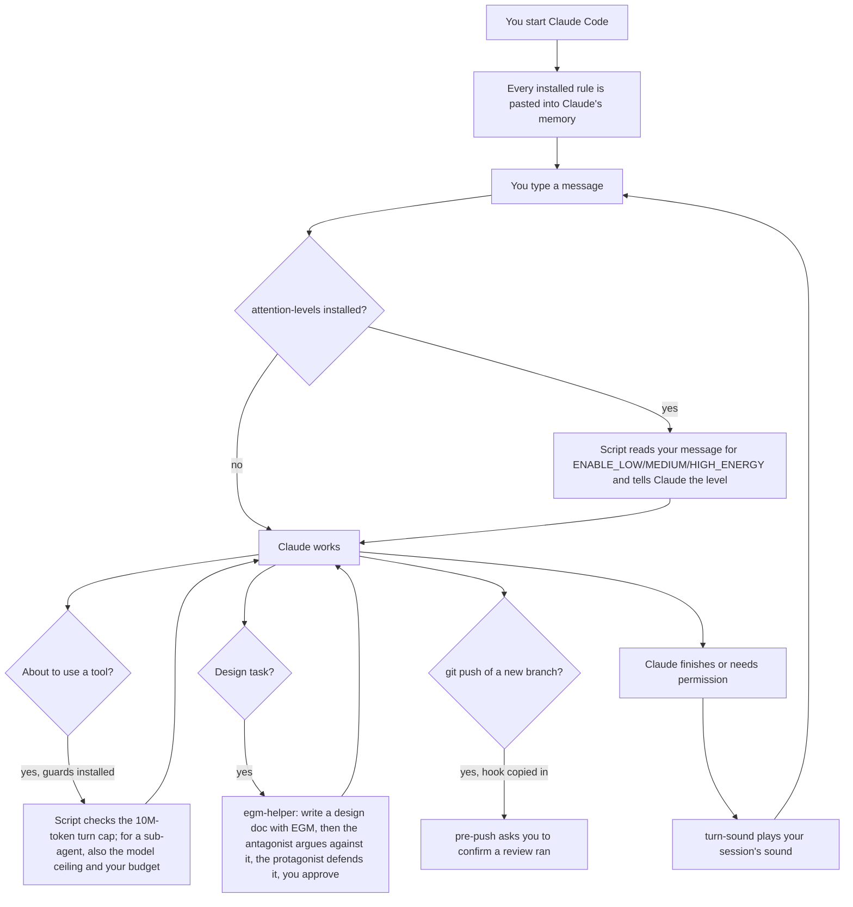

# agent-kit

My Claude Code setup, split into small plugins you can pick from. It adds rules that make the agent write safer code, debug more carefully and review plans before building them. Some extras are just fun, like a sound when it's your turn.

You don't need to understand any of it to install it. Copy the commands below.

## Before you start

You need [Claude Code](https://code.claude.com/docs/en/setup) installed and logged in. Check by opening a terminal and typing:

```
claude --version
```

If that prints a version number, you're ready.

## Install the Starter pack (recommended)

Paste these four lines into your terminal, one at a time. The last two add Google's design-doc workflow (EGM), which the Starter pack uses. EGM is spec-driven development: a spec is written and reviewed before any code.

```
claude plugin marketplace add danyshs/agent-kit
claude plugin install starter@agent-kit
claude plugin marketplace add google/elephant-goldfish-model
claude plugin install egm@egm
```

Then start a new Claude Code session. The rules load at the start of every session.

To check everything installed, run `claude plugin list`. You should see `starter`, `tiger-style-core`, `debugging-discipline`, `antagonist-protagonist`, `egm-helper`, `single-evidence-ledger` and `egm`.

Works on macOS and Linux. Windows is untested. Last tested Claude Code version: see `SNAPSHOT`.

## How it works

### The four kinds of parts

Every plugin here is built from one or more of these:

| Part | What it is | When it's used |
|---|---|---|
| **Rule** | A page of plain-English instructions for Claude, like "check every claim against the code". | Pasted into Claude's memory at the start of every session, by a small hook that prints the rule's text. |
| **Skill** | A longer guide Claude reads only when it's needed, like the tiger-style coding rules. | Loaded when you ask for it ("review this with tiger style"). Costs nothing until then. |
| **Agent** | A helper Claude can start, with its own instructions and read-only access to your files. | Started by Claude when a rule tells it to (the antagonist and protagonist reviewers). |
| **Script** | A small program Claude Code runs on an event: when you send a message, before a tool runs, when Claude finishes. | Runs automatically. Claude doesn't choose to run it. |

### What happens during a session, in order



Step by step:

1. **Session starts.** Each rule plugin's hook prints its rule, and Claude reads it as instructions. Every rule begins with `rule: <name>`, so you can ask Claude which ones it has.
2. **You send a message.** With `attention-levels`, a script looks for `(ENABLE_LOW_ENERGY)`, `(ENABLE_MEDIUM_ENERGY)` or `(ENABLE_HIGH_ENERGY)`, saves the level for this session, and adds a line like `Attention level: Low` to your message. The rule tells Claude how many questions to ask at each level.
3. **Claude writes or reviews code.** If you ask for tiger style, Claude loads the `tiger-style` skill and the skill for your language, if you installed it. The `debugging-discipline` rule is always on.
4. **Before each tool call.** With `guards`, a script counts the tokens used this turn and stops at 10 million. Before a sub-agent starts, it also refuses models priced above Opus 5.5 and launches that would pass the budget you typed (`budget $5`).
5. **A question only running things can answer.** With `rhino-owl`, Claude proposes a Rhino-Owl run instead of guessing; it starts only after you set or approve a budget. See [Rhino-Owl](#rhino-owl-finding-out-by-running-things).
6. **A task needs a design decision.** The `egm-helper` rule makes Claude write a design doc first, using Google's EGM plugin. Before you approve it, the `antagonist-protagonist` rule has Claude start two reviewers: one argues against the doc, the other defends it. Claude shows you a table of their points and you decide.
7. **Claude stops.** With `turn-sound`, a sound plays when Claude finishes or needs your permission. Each session gets its own sound, so you can tell parallel sessions apart.
8. **You push a new branch.** If you copied the `pre-push` git hook into the repo, it asks whether a code review ran. Claude can't answer a terminal prompt, so it runs a tiger-style review first and then pushes with `REVIEW_DONE=1`.

The other rules (`when-to-ask`, `agent-orchestration`, `single-evidence-ledger`, `code-voice`, `fork-pr-check`) have no scripts. They change how Claude behaves throughout the session.

### Every plugin and its parts

| Plugin | Rule | Skill | Agents | Scripts, and when they run | Files it writes |
|---|---|---|---|---|---|
| `starter` | none | none | none | none. Installing it installs the five Starter modules below. | none |
| `tiger-style-core` | none | `tiger-style` (guide, principles, review checklist, TigerBeetle's original) | none | none | none |
| `tiger-style-<language>` (9) | none | one per language | none | none | none |
| `debugging-discipline` | yes | none | none | none | none |
| `antagonist-protagonist` | yes | none | `antagonist`, `protagonist` | none | `pushback_report.md` next to the doc being reviewed |
| `egm-helper` | yes | none (uses the EGM plugin's) | none | none | design docs under `docs/designs/` in your project |
| `when-to-ask` | yes | none | none | none | none |
| `attention-levels` | yes | none | none | `attention.py` on every message; `lowlog.py` when Claude logs a Low-level decision | `~/.claude/attention/`, `~/.claude/lowlog/` |
| `guards` | yes | none | none | `guard.py` before every tool call; price table `prices.json` | none (it only reads session logs) |
| `turn-sound` | none | none | none | `beep.sh` when Claude stops or asks permission | cached sounds in your temp folder |
| `pre-push` | yes | none | none | `git-hook/pre-push`, run by git, only if you copy it in | none |
| `agent-orchestration` | yes | none | none | none | none |
| `single-evidence-ledger` | yes | none | none | none | `FACTS.md` in your project, when Claude starts one |
| `rhino-owl` | yes | `rhino-owl` (how to run it) | none | `rhino.py`, only when Claude runs it for an exploration; it starts headless `claude -p` runs | rhino worktrees under `.claude/worktrees/`, a results file, `proposed-ledger.md` and `rom-evidence/` next to your launch sheet |
| `code-voice` | yes | none | none | none | none |
| `fork-pr-check` | yes | none | none | none | none |

Not a plugin: `snippets/statusline.sh`, a status bar you can turn on by hand (see [SETUP.md](SETUP.md#status-line)).

### Where things are

- In this repo, each plugin is a folder under `plugins/`. Every rule is also a plain file in `rules/`, so you can read it before installing.
- On your computer, Claude Code keeps installed plugins under `~/.claude/plugins/`.

## What's in it

Install any single module with `claude plugin install <name>@agent-kit`. Remove one with `claude plugin uninstall <name>@agent-kit`.

### Starter pack (what `starter` installs)

| Module | What it does |
|---|---|
| `tiger-style-core` | Coding rules from TigerBeetle's TigerStyle: safety first, a limit on everything, lots of assertions. It loads only when you ask, for example "review this with tiger style". |
| `debugging-discipline` | Seven debugging rules, each from a real mistake. For example: exit code 0 doesn't prove a check passed. |
| `antagonist-protagonist` | Before you approve a plan, one agent argues against it and another defends it. You decide. |
| `egm-helper` | When to write a design doc first, and how to run Google's EGM review on it. This is spec-driven development. |
| `single-evidence-ledger` | Each fact lives in one place, and long debugging keeps a `FACTS.md` file. See [FACTS.md](#factsmd-how-a-guess-becomes-a-fact). |

### Language rules for tiger-style (pick the ones you use)

`tiger-style-python`, `tiger-style-typescript`, `tiger-style-rust`, `tiger-style-go`, `tiger-style-c`, `tiger-style-cpp`, `tiger-style-java`, `tiger-style-lua`, `tiger-style-fish`

Example: `claude plugin install tiger-style-python@agent-kit`

### Optional features

| Module | What it does |
|---|---|
| `turn-sound` | Plays a short sound when Claude is waiting for you. Each session gets its own sound. Needs jq and ffmpeg for the per-session sounds. Without them a Mac plays a system chime and Linux stays silent. |
| `attention-levels` | Type `(ENABLE_LOW_ENERGY)` on a tired day and Claude asks fewer questions. `(ENABLE_HIGH_ENERGY)` makes it ask more. `(ENABLE_MEDIUM_ENERGY)` is the normal setting. Needs python3. |
| `when-to-ask` | Claude just does safe, undoable work instead of asking "should I?", and runs all its checks before saying "done". |
| `guards` | Limits spending. Type `budget $5` and Claude can't launch sub-agents or rhinos past $5. Without a budget, sub-agents still launch. It also refuses any model priced above Opus 5.5, and stops after 10 million tokens in one turn. Prices are per-token API prices. Does nothing if python3 is missing. |
| `rhino-owl` | The Rhino-Owl model: throwaway prototype runs for questions only running things can answer. Needs `guards`, and won't start until you set or approve a budget. See [Rhino-Owl](#rhino-owl-finding-out-by-running-things). |
| `pre-push` | A git hook that asks you to confirm a code review ran before the first push of a branch. It's a reminder, not a lock: it can't check that a review really happened. Needs a manual step, see [SETUP.md](SETUP.md#pre-push). |

A status line (the bar under the prompt showing model, git branch, tokens and cost) is in `snippets/statusline.sh`. It isn't a plugin; [SETUP.md](SETUP.md#status-line) shows how to turn it on.

### Extras

| Module | What it does |
|---|---|
| `agent-orchestration` | When Claude should use sub-agents and when it shouldn't, and how to keep its memory uncluttered. |
| `code-voice` | My taste in comments and code: short, explains why, no class hierarchies by default. Take it only if you share the taste. |
| `fork-pr-check` | When working in a fork, makes Claude check the right repo before saying "there's no PR". |

### FACTS.md: how a guess becomes a fact

For debugging or research that runs past one session, Claude keeps one `FACTS.md` at the project root. Every row has an ID that is never reused, and rows are never deleted: a wrong one gets a new row saying so.

| Table | Holds | Example |
|---|---|---|
| **F**, fact | Something observed, with its evidence: a file and line, a log line, command output, or what you saw. | F3: the driver drops reports over 64 bytes (`dmesg` line, saved to `evidence/`) |
| **D**, derivation | A conclusion, the rows it rests on, and the rule that links them. | D1: from F3 and F5, the overflow is in the driver, not the app |
| **H**, hypothesis | A guess, and what would settle it. Never cited as a fact. | H2: a smaller report size would fix it |
| **T**, test | Written before the change: the one thing changed, the result if the guess is right, the result if it's wrong. | T4: set the report size to 32; works if H2 is right |

One variable per test, because a test that changes two things settles neither. Handoffs and design docs cite row IDs instead of restating facts, so a note can't go stale.

### Rhino-Owl: finding out by running things

Some questions can't be answered by reading: the docs are thin, the forums disagree, or the truth is in code you can't see. For those, the Rhino-Owl model (ROM) replaces guessing with cheap, throwaway runs. ROM is an implementation of prototype-driven development: build quick prototypes to learn what's true, then throw them away.

The two fit together. EGM (spec-driven) decides how to build something; ROM (prototype-driven) finds out what's true when reading can't. ROM's results can feed an EGM spec as evidence, and you can install either one without the other.

1. **Claude proposes it**, names what it already read and why that didn't settle it, and shows a launch sheet: up to four routes, each with a model and a dollar cap. Nothing runs until you approve the budget.
2. **Rhinos charge down one route each** with almost no planning. Each is a headless Claude run in its own git worktree, with a dollar cap, the OS sandbox, a deny list, and none of your rules or settings loaded. Some are *controls*: they try a route expected to be weaker, so comparisons rest on results rather than opinion. A failed rhino is a finding, not a waste.
3. **The Owl** is a fresh run that starts after the rhinos finish. It reads what they built and how they failed, and writes rows for `FACTS.md`. It never picks a winner; that's yours.
4. **The rhinos' code is thrown away.** Only the Owl's rows survive. If you then build the real thing, it's a normal task, with the rows as evidence.

**Rhinos start bare, on purpose.** They run without your rules, CLAUDE.md, settings, hooks, plugins or MCP servers, which is what keeps them cheap. If you want them to run with your rules anyway, ask Claude to add `scaffolding` to the launch sheet (the `rhino-owl` skill shows how). It can load your user or project settings, or only the rule files you name. A heavier start comes out of each rhino's dollar cap, so a bloated one can stop before it builds much of a prototype. Raise the caps to make up for it.

An optional module that needs `guards`. Every rhino is a paid run, and the `guards` budget counts its spend like any sub-agent's.

## Is it working?

Start Claude Code and ask: "Quote every line in your context that starts with rule:". Each rule begins with a line like `rule: debugging-discipline`, so Claude should list one per installed rule module.

To check the tools the optional features need, download and run the doctor script:

```
curl -fsSL https://raw.githubusercontent.com/danyshs/agent-kit/main/bin/doctor | sh
```

## Evals and trajectory analysis (`tools/`)

Two more tools ship under `tools/` as a kit to fork, not a product: `tools/evals` and `tools/trajectory`. They ship without my ledgers, session logs or private rules. Swap in your own rules and cases; `tools/README.md` says how. Both run on Claude Code first and still support [Kiro](https://kiro.dev)'s CLI, the agent I used before. Every eval result below came from Kiro runs; the Claude Code runner has passed small test runs but no full suite yet. The method doesn't depend on the CLI. This section says how each tool works, what it has found so far, and what it can't tell you yet.

### Evals: does a rule change what the agent does?

A rule earns its place only if the agent behaves differently with it. The eval suite tests that by running the agent with and without the rule and comparing.

**1. Static checks (free, no model calls).** Before anything runs, a linter reads every rule and skill file and checks: the file parses and has the right header; a skill's name matches its folder and it has a description of sane length; every file a skill points to exists; each file is under a size limit; and all the always-on rules together fit a context budget. It also lists every rule and skill as covered or uncovered by a test suite, so a gap is visible. It does not check whether two rules contradict each other; nothing does yet.

**2. Test cases.** Each rule gets a small set of prompts, written as JSON. Every case says which rule it tests and what kind of case it is:

- **fire**: the rule should change the answer ("print 1 to 3 with a for loop", for the fish-shell rule);
- **no-fire**: the rule should stay quiet (running an existing bash script is allowed);
- **pressure**: the prompt pushes against the rule (the user asks for a heredoc).

Each case lists **assertions**, and each assertion is a small code check, not a model's opinion: a tool was used or not used, the shell command parses as fish, there's no heredoc, no file outside the project was read, stderr was empty. Graders read the agent's actual tool calls from the session log, not its summary of what it did. A grader that finds no evidence fails, and "unknown" never counts as a pass.

**3. Arms.** Every case runs in up to three setups, each in a fresh, throwaway config folder holding only what that setup names:

- **full**: all my rules;
- **minus-the-rule**: all my rules except the one under test;
- **none**: no rules at all.

On Claude Code each run is a headless `claude -p` that loads none of my own settings, rules, hooks or MCP servers. The setup's rules go into a `CLAUDE.md` in a throwaway folder, which Claude Code reads the way it reads mine in a real session; its skills load as a throwaway plugin; and any tool the case doesn't allow is denied without asking. A small test run checked that a rule loaded this way reaches the model and that my own rules stay out. A run that loads a skill its setup didn't include is marked contaminated, because that means the isolation leaked. Runs are pinned to one model and one CLI version, and capped per run and per suite in wall time and in dollars (credits on Kiro). A run over its cap is recorded as aborted, not dropped. Before a suite starts it prints its worst-case run count and cost, and refuses to start over budget.

**4. Scoring.** A run passes when all its hard assertions pass. Arms are compared case by case: for each case, pass rate with the rule minus pass rate without it, then the mean of those differences with a bootstrap interval. Only cases that pass in **full** are counted, so a broken case can't make a rule look useless. With fewer than 8 cases there's no interval, only raw counts. Every run goes into an append-only ledger, and reports are built from the ledger alone.

**5. Verdicts never say "delete".** A rule that shows no difference gets "watch" or "non-discriminating", because one small suite can't prove a rule is dead. The loop for changing a rule is: propose one edit, re-run both arms, keep the edit only if the pass rate holds and cost doesn't rise.

**Value tests** go further for code style: does tiger-style make the code better? The agent writes small Python and fish programs, and hidden tests the agent never sees run on its output in a sandbox with no network. It also reviews code with planted bugs, scored on how many it finds and how many false alarms it raises on clean code. The hypotheses and analysis were written down before the first run, so the bar couldn't move after the results came in.

**What it has found so far** (November 2026, cheapest model only, one run per case):

| Rule | Cases | Result |
|---|---|---|
| fish-shell rule | 8 | Changed the answer in 1 case (the user asking for a heredoc). Watch. |
| tiger-style-on-branches rule | 8 | 5 cases broken even with all rules on, so only 3 counted. Watch. |
| tiger-style, value pilot | 4 cases, 24 runs | No difference: every arm passed every hidden test. On code review, the one hint was an unbounded fish loop found in 2 of 4 tiger-style runs and 0 of 2 without it. A count, not a result. |

The honest summary: so far no rule has been shown to help or to hurt, the suites are too small to say, and the static check shows my always-on rules are over their own context budget.

### Trajectory analysis: what do my sessions actually look like?

The agent CLIs already write a log of every session: each tool call, its result and the tokens used. The trajectory tool reads those logs. It runs by itself every Sunday and pops a notification when the week's report is ready.

**1. Read and strip.** A reader per CLI (Claude Code, then Kiro) turns each session log into one small, versioned record: the session, its turns, and each turn's steps (tool, a hash of its arguments, a hash of its target file, status, exit code, timing, sub-agent depth, which calls went out in parallel). No free text survives: prompts, replies and file contents are dropped, arguments become hashes, and names that don't match a strict pattern become `(other)`. A test plants a canary string in every text field of the fixtures and fails if it ever shows up in the output. Every write is validated against the schema.

**2. Count what was skipped.** Logs that are corrupt, too big or in an unknown format are counted, not silently dropped. Every report ends with a coverage table (files read, skipped and why, events used out of events seen), so "no findings" can't be confused with "nothing read".

**3. Sanity checks.** A build fails, instead of reporting, when the data looks wrong. These exist because each one happened: a reply logged as several lines, each repeating the same token usage (so usage is counted once per reply), negative durations from subtracting permission-prompt waits, and turn counts inflated by system messages that look like user messages.

**4. Weekly report.** Sessions per week, calls and errors per tool, and cost per turn. Counts are information, not failures: a missing value prints "n/a", never zero, and an expensive session isn't a failed one.

**5. Weekly corrections list.** A second list quotes the moments I stopped or corrected the agent: every interrupt and the message I typed after it, every rejected tool call with my reason, and short messages that read like a correction ("no, ...", "that's wrong"). Those are the moments worth learning from. This list is the only output that keeps my words, and it stays in one local file.

**Not built yet:**

- Detectors for loops, retry chains, repeated reads of the same file and error streaks.
- Checks that a session followed a rule (for example, no heredoc in any shell call).
- A paid step that has a model read the flagged sessions and the corrections list, to find which rule should have prevented each correction.

Until those exist, the tool shows where time and money went and when I had to step in. It does not yet connect a correction to a rule, and none of its thresholds have been checked against hand-labelled sessions.

### How the two fit together

Evals ask whether a rule changes behaviour in a controlled test. Trajectories show what happens in real work. The plan is to join them: a correction that keeps recurring becomes a new eval case, and a rule that never shows up in real sessions and never changes a test result is the first one to cut. The tiger-style suite in `tools/evals/skills/tiger-style` runs as shipped. The fish-shell and branch-review suites show how a rule suite is laid out; the rules they test stay private, so they don't run as shipped.

## Credits and licence

- TigerStyle is by TigerBeetle (Apache-2.0); the original guide is included unchanged in `tiger-style-core`.
- EGM (the Elephant-Goldfish Model) is by Google: https://github.com/google/elephant-goldfish-model
- Everything else is Apache-2.0, see [LICENSE](LICENSE).

`SNAPSHOT` says which Claude Code version this was last tested with.
