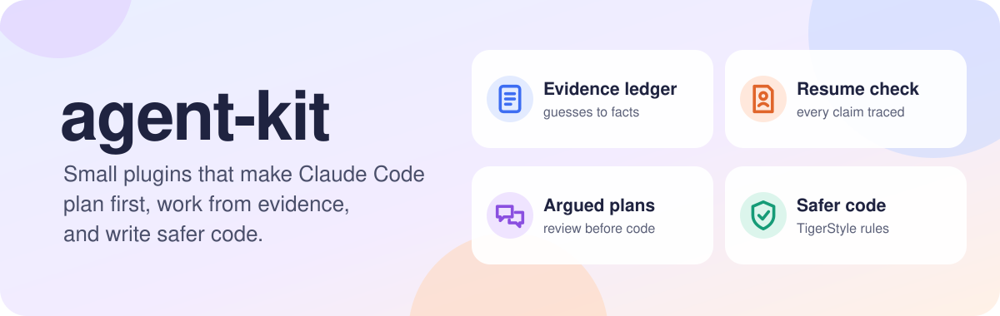

<p align="center"></p>

<p align="center"><a href="#flagship-plugins">Plugins</a> · <a href="#install">Install</a> · <a href="#how-it-works">How it works</a> · <a href="REFERENCE.md">Reference</a></p>

*Updated November 2026 · macOS and Linux · Apache-2.0*

Claude Code is quick to start writing. Sometimes too quick: it builds on a guess, reads an exit code of 0 as proof a check passed, or starts on a plan nobody argued with. agent-kit is my Claude Code setup, split into small plugins that fix those habits, plus a few quality-of-life extras like a sound when it's your turn.

Each plugin does one thing. Skim the tables below, note the ones that fit how you work, and install those. If you're not sure, the Starter pack (★) is a good default: one install covers all four.

## Flagship plugins

The main reasons to use the kit. Each changes how Claude plans, debugs, codes or does a job.

★ = **Star**ter pack: the four plugins marked with it come in one install.

"Needs" is blank when there's nothing extra to install.

### Evidence and research

| Plugin | What it does | Pick it if | Needs |
|---|---|---|---|
| ★ `single-evidence-ledger` | Each fact lives in one place. Long debugging keeps a `FACTS.md` of hypotheses, tests and facts with evidence. | Your debugging runs across several sessions. | |

### Resume work

| Plugin | What it does | Pick it if | Needs |
|---|---|---|---|
| `resume-kit` | `/resume` checks a LaTeX resume against a job posting and refines it in a loop; every number and date must trace to your own evidence file. `/resume-setup` gets you started. | You're job hunting with a LaTeX resume. | python3 or uv; a LaTeX build |

### Planning and review

| Plugin | What it does | Pick it if | Needs |
|---|---|---|---|
| ★ `egm-helper` | Spots when a task needs a design doc before any code, then runs it through Google's EGM review: fresh reviewers who see only the doc. | Claude keeps building the wrong thing, or you want to sign off before it starts. | `egm` (installed below) |
| ★ `antagonist-protagonist` | Before you approve a plan, one reviewer argues against it and another checks the fixes didn't go too far. You get one table to decide from. | You approve plans and want the weak spots shown first. | |
| `rhino-owl` | Runs up to four throwaway prototypes, each with a dollar cap you approve, to answer a question reading can't. Keeps the findings, throws the code away. | You hit questions where the docs are thin or contradict each other. | `guards` |

### Coding

| Plugin | What it does | Pick it if | Needs |
|---|---|---|---|
| ★ `tiger-style-core` | TigerBeetle's TigerStyle: safety first, a limit on everything, lots of assertions. Loads when you ask ("review this with tiger style"). | You want stricter, safer code or a hard code review. | |

## Support plugins

Smaller helpers: add-ons for the flagships, limits and quality-of-life. Take the ones that fit.

### Coding add-ons

| Plugin | What it does | Pick it if | Needs |
|---|---|---|---|
| `tiger-style-<language>` | TigerStyle details for python, typescript, rust, go, c, cpp, java, lua or fish. | You use `tiger-style-core`. Take the languages you write. | `tiger-style-core` |
| `code-voice` | My taste in comments and code: short, says why, no class hierarchies by default. | You like that style too. | |

### Debugging

| Plugin | What it does | Pick it if | Needs |
|---|---|---|---|
| `debugging-discipline` | Seven debugging rules, each from a real mistake. Example: exit code 0 doesn't prove a check passed. | You debug with Claude at all. | |

### Cost control

| Plugin | What it does | Pick it if | Needs |
|---|---|---|---|
| `guards` | Spending limits on sub-agents, a model price ceiling and a per-turn token cap. | You pay per token and want hard limits. | python3 |

### Working with Claude

| Plugin | What it does | Pick it if | Needs |
|---|---|---|---|
| `when-to-ask` | Claude does safe, undoable work without asking, and runs every check once before saying "done". | Claude asks you too much, or says "done" too early. | |
| `attention-levels` | Type `(ENABLE_LOW_ENERGY)` on a tired day and Claude asks fewer questions; `(ENABLE_HIGH_ENERGY)` for more. | Your energy varies and you want Claude to match it. | python3 |
| `turn-sound` | A short sound when Claude finishes or needs you, different per session. | You run several sessions at once or look away while it works. | jq, ffmpeg (else a Mac chime) |
| `agent-orchestration` | When Claude should use sub-agents and when not, and how to keep context small. | Claude spawns sub-agents for everything, or never. | |

### Git and GitHub

| Plugin | What it does | Pick it if | Needs |
|---|---|---|---|
| `pre-push` | Asks you to confirm a review ran before a branch's first push. A reminder, not a lock. | You want a review before anything leaves your machine. | git; [manual step](SETUP.md#pre-push) |
| `fork-pr-check` | In a fork, Claude checks the right repo before saying "there's no PR". | You contribute to other people's projects through forks. | |

## Install

You need [Claude Code](https://code.claude.com/docs/en/setup): `claude --version` should print a version number. Add the kit, then install what you picked. For the Starter pack, paste these four lines, one at a time:

```
claude plugin marketplace add danyshs/agent-kit
claude plugin install starter@agent-kit
claude plugin marketplace add google/elephant-goldfish-model
claude plugin install egm@egm
```

The last two add Google's EGM (Elephant-Goldfish Model) plugin, which the Starter pack builds on. Start a new Claude Code session afterwards, since rules load when a session starts.

**Check it worked:** inside a session, ask Claude *"Quote every line in your context that starts with rule:"*. You should get one line per installed rule, like `rule: debugging-discipline`.

For any other plugin: `claude plugin install <name>@agent-kit`. To remove one: `claude plugin uninstall <name>@agent-kit`. Some plugins need python3, jq or ffmpeg; to check what you have:

```
curl -fsSL https://raw.githubusercontent.com/danyshs/agent-kit/main/bin/doctor | sh
```


## How it works

### Plans get argued over before code

The ★ planning plugins together. For any task where "how should this work?" has more than one honest answer, Claude writes a design doc first. Fresh reviewers who see only the doc look for holes. Then an antagonist argues against the plan and a protagonist checks the fixes didn't go too far. You get one table, approve it, and Claude builds what the doc says and nothing more. Small, clear fixes skip all of this.

<p align="center"></p>

### Guesses become facts

For debugging that runs past one session, Claude keeps a `FACTS.md` with four kinds of rows: hypotheses, tests (written before the change, one variable each), facts (with evidence) and conclusions drawn from them. Rows are never deleted or reused, so notes can't quietly drift out of date.

### Prototypes answer what reading can't

When the docs are thin or the forums disagree, `rhino-owl` runs up to four throwaway prototypes, each with a dollar cap you approve. A fresh run then turns what they built and how they failed into rows for `FACTS.md`. The prototype code is thrown away.

## Status

**A personal setup, shared as is.** It's tested on macOS with the Claude Code version in [`SNAPSHOT`](SNAPSHOT). Windows is untested. Questions and bugs go to [GitHub issues](https://github.com/danyshs/agent-kit/issues).

**No rule is proven yet.** I test whether each rule changes what Claude does, with and without it, and the suites are still too small to say. One early sign: with the tiger-style skill, Claude found 9 of 9 planted bugs in review, against 6 of 9 without it. The test tools are in [`tools/`](tools/README.md) to fork.

**Next:** bigger eval suites, detectors for loops and repeated reads in real sessions, and turning corrections I keep making into test cases.

## Learn more

- [REFERENCE.md](REFERENCE.md): every plugin's parts, the files it writes, settings, and the eval tools in full.
- [SETUP.md](SETUP.md): manual steps (pre-push hook, status line), guard limits, and removing things.
- [tools/README.md](tools/README.md): running the evals and trajectory tools.

## Acknowledgements

- TigerStyle is by TigerBeetle (Apache-2.0); the original guide is included unchanged in `tiger-style-core`.
- EGM (the Elephant-Goldfish Model) is by Google: https://github.com/google/elephant-goldfish-model
- Everything else is Apache-2.0, see [LICENSE](LICENSE).
