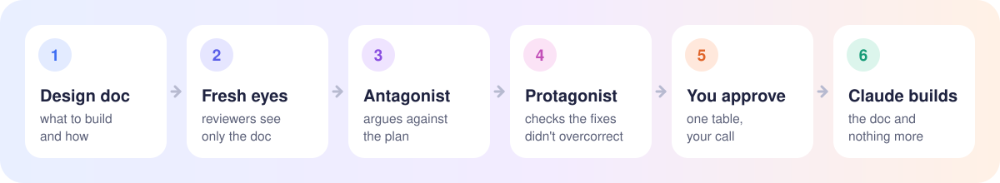

<p align="center"></p>

<p align="center"><a href="https://github.com/danyshs/agent-kit/actions/workflows/check.yml"></a></p>

<p align="center"><a href="#flagship-plugins">Plugins</a> · <a href="#install">Install</a> · <a href="#how-it-works">How it works</a> · <a href="#plugin-docs">Plugin docs</a></p>

*Updated November 2026 · tested on macOS · Apache-2.0*

Claude Code is quick to start writing. Sometimes too quick: it builds on a guess, reads an exit code of 0 as proof a check passed, or starts on a plan nobody argued with. agent-kit is my Claude Code setup, split into small plugins that fix those habits, plus a few quality-of-life extras like a sound when it's your turn.

Each plugin does one thing. Skim the tables below, note the ones that fit how you work, and install those. If you're not sure, the Starter pack (★) is a good default: one install covers all four.

## What the code does, shown

The `guards` plugin refusing a sub-agent launch. I had typed `budget $5` and sub-agents had already spent $4.98, so the hook exits 2 and Claude Code blocks the launch:

```
guard: refused: spend $4.98 + launch floor $0.15 is over the budget; spent $4.98 of $5.00; fix: user types a higher 'budget $N' line; model sonnet
```

A launch that names a model priced above Opus is refused the same way:

```
guard: refused: model fable is above the ceiling claude-opus-5-5 (in 10.0 > 4.0 $/M); fix: name a model at or below Opus in the launch
```

`traj` turns session logs into counts and never copies message text. Part of its report on the two sample sessions in `tools/trajectory/tests/fixtures/`:

```
| tool         | steps | with result | errors |
| read_file    | 5     | 4           | 0      |
| execute_bash | 3     | 3           | 1      |
| grep_search  | 2     | 2           | 1      |
```

CI runs `lint.sh` (ruff, pyright strict, shellcheck, fish), the guard tests and the eval and trajectory suites on every push. Everything runs offline, and a skipped test fails the run. Code worth reading first:

- [`guard.py`](plugins/guards/scripts/guard.py): reads the transcript backwards in 1 MB blocks (`lines_reversed`) and counts each message's usage once (`dedup_usage`). Standard library only.
- [`isolation.py`](tools/evals/lib/isolation.py): an eval won't start with a tool name nobody has classified, so a bare file tool can't slip into a headless run.
- [`quality.py`](tools/trajectory/traj/quality.py): the data-quality limits are checked in integer arithmetic, not floats.

## Flagship plugins

The main reasons to use the kit. Each changes how Claude plans, researches, codes or spends.

★ = **Star**ter pack: the four plugins marked with it come in one install.

"Needs" is blank when there's nothing extra to install.

### Evidence and research

| Plugin | What it does | Pick it if | Needs | Install |
|---|---|---|---|---|
| ★ [`single-evidence-ledger`](plugins/single-evidence-ledger/README.md) | Keeps what Claude knows trustworthy across sessions: every fact has one home, notes say when they were last checked, and long research or debugging keeps a `FACTS.md` where a guess can't pass as a fact until a test settles it. | Your work spans many sessions, or Claude acts on stale notes or unproven guesses. | | `claude plugin install single-evidence-ledger@agent-kit` |

### Planning and review

| Plugin | What it does | Pick it if | Needs | Install |
|---|---|---|---|---|
| ★ [`antagonist-protagonist`](plugins/antagonist-protagonist/README.md) | Before you approve a plan, one reviewer argues against it and another checks the fixes didn't go too far. You get one table to decide from. | You approve plans and want the weak spots shown first. | | `claude plugin install antagonist-protagonist@agent-kit` |
| [`egm-helper`](plugins/egm-helper/README.md) | Spots when a task needs a design doc before any code, then runs it through Google's EGM review: fresh reviewers who see only the doc. | Claude keeps building the wrong thing, or you want to sign off before it starts. | `egm` ([adding EGM](#adding-egm)) | `claude plugin install egm-helper@agent-kit` |
| [`rhino-owl`](plugins/rhino-owl/README.md) | Runs up to four throwaway prototypes, each with a dollar cap you approve, to answer a question reading can't. Keeps the findings, throws the code away. | You hit questions where the docs are thin or contradict each other. | `guards` | `claude plugin install rhino-owl@agent-kit` |

### Coding

| Plugin | What it does | Pick it if | Needs | Install |
|---|---|---|---|---|
| ★ [`tiger-style`](plugins/tiger-style/README.md) | TigerBeetle's TigerStyle: safety first, a limit on everything, lots of assertions. Rules for Python, TypeScript, Rust, Go, C, C++, Java, Lua and fish; Claude reads only the file for the language at hand. Loads when you ask ("review this with tiger style"). | You want stricter, safer code or a hard code review. | | `claude plugin install tiger-style@agent-kit` |

### Limits and cost

| Plugin | What it does | Pick it if | Needs | Install |
|---|---|---|---|---|
| ★ [`guards`](plugins/guards/README.md) | Hooks that refuse a sub-agent launch over the budget you typed or above a model price ceiling, and stop a turn past a token cap. Without a budget, launches go through with a note. | You pay per token and want hard limits. | python3 | `claude plugin install guards@agent-kit` |

## Support plugins

Smaller helpers: lessons that keep Claude honest, and add-ons for the flagships. Take the ones that fit.

### Lessons from working with Claude

| Plugin | What it does | Pick it if | Needs | Install |
|---|---|---|---|---|
| [`debugging-discipline`](plugins/debugging-discipline/README.md) | Seven debugging rules, each from a real mistake. Example: exit code 0 doesn't prove a check passed. | You debug with Claude at all. | | `claude plugin install debugging-discipline@agent-kit` |
| [`when-to-ask`](plugins/when-to-ask/README.md) | Claude does safe, undoable work without asking, and runs every check once before saying "done". | Claude asks you too much, or says "done" too early. | | `claude plugin install when-to-ask@agent-kit` |

### Sub-agents

| Plugin | What it does | Pick it if | Needs | Install |
|---|---|---|---|---|
| [`agent-orchestration`](plugins/agent-orchestration/README.md) | When Claude should use sub-agents and when not, and how to keep context small. | Claude spawns sub-agents for everything, or never. | | `claude plugin install agent-orchestration@agent-kit` |

### Git and GitHub

| Plugin | What it does | Pick it if | Needs | Install |
|---|---|---|---|---|
| [`pre-push`](plugins/pre-push/README.md) | Before a branch's first push (not main), asks you to confirm a review ran. It takes your word for it. | You want a review before anything leaves your machine. | git, `tiger-style`; [manual step](SETUP.md#pre-push) | `claude plugin install pre-push@agent-kit` |
| [`fork-pr-check`](plugins/fork-pr-check/README.md) | In a fork, Claude checks the right repo before saying "there's no PR". | You contribute to other people's projects through forks. | | `claude plugin install fork-pr-check@agent-kit` |

## Install

You need [Claude Code](https://code.claude.com/docs/en/setup): `claude --version` should print a version number. Add the kit, then install what you picked. **The Starter pack is four plugins, not everything:** `single-evidence-ledger`, `antagonist-protagonist`, `tiger-style` and `guards`. Every other plugin is a separate install, with its command in the Install column of the tables above.

For the Starter pack, paste these commands, one at a time:

```
claude plugin marketplace add danyshs/agent-kit
claude plugin install starter@agent-kit
```

`guards` needs python3. Start a new Claude Code session afterwards, since rules load when a session starts.

**Check it worked:** inside a session, ask Claude *"Quote every line in your context that starts with rule:"*. You should get one line per installed rule, like `rule: single-evidence-ledger`.

For any other plugin: `claude plugin install <name>@agent-kit`. To remove one: `claude plugin uninstall <name>@agent-kit`. Some plugins need python3, jq or ffmpeg. To check what you have, run the doctor script from the copy of this repo that Claude Code keeps once the marketplace is added:

```
sh ~/.claude/plugins/marketplaces/agent-kit/bin/doctor
```

### Adding EGM

`egm-helper` builds on Google's EGM (Elephant-Goldfish Model) plugin, a separate install:

```
claude plugin marketplace add google/elephant-goldfish-model
claude plugin install egm@egm
claude plugin install egm-helper@agent-kit
```

## How it works

### Plans get argued over before code

`egm-helper` and `antagonist-protagonist` together. For any task where "how should this work?" has more than one honest answer, Claude writes a design doc first. Fresh reviewers who see only the doc look for holes. Then an antagonist argues against the plan and a protagonist checks the fixes didn't go too far. You get one table, approve it, and Claude builds what the doc says and nothing more. Small, clear fixes skip all of this. `antagonist-protagonist` on its own runs the last two reviewers on any plan you're about to approve.

<p align="center"></p>

### Guesses become facts

For research, debugging or reverse-engineering that runs past one session, Claude keeps a `FACTS.md` with four kinds of rows: hypotheses, tests (written before the change, one variable each), facts (with evidence) and conclusions drawn from them. Rows are never deleted or reused, so notes can't quietly drift out of date.

### Prototypes answer what reading can't

When the docs are thin or the forums disagree, `rhino-owl` runs up to four throwaway prototypes, each with a dollar cap you approve. A fresh run then turns what they built and how they failed into rows for `FACTS.md`. The prototype code is thrown away.

## Personal ergonomics

Opinionated workflow comforts (off by default), separate from core safety and eval primitives. They fit how I work; nothing else in the kit needs them.

| Plugin | What it does | Pick it if | Needs | Install |
|---|---|---|---|---|
| [`attention-levels`](plugins/attention-levels/README.md) | Type `(ENABLE_LOW_ENERGY)` on a tired day and Claude asks fewer questions; `(ENABLE_HIGH_ENERGY)` for more. | Your energy varies and you want Claude to match it. | python3 | `claude plugin install attention-levels@agent-kit` |
| [`turn-sound`](plugins/turn-sound/README.md) | A short sound when Claude finishes or needs you, different per session. | You run several sessions at once or look away while it works. | jq, ffmpeg (else a Mac chime; silent on Linux) | `claude plugin install turn-sound@agent-kit` |
| [`code-voice`](plugins/code-voice/README.md) | My taste in comments and code: short, says why, no class hierarchies by default. | You like that style too. | | `claude plugin install code-voice@agent-kit` |
| `resume-kit` | `/resume` checks a LaTeX resume against a job posting and refines it in a loop; every number and date must trace to your own evidence file. `/resume-setup` gets you started. | You're job hunting with a LaTeX resume. | python3 or uv; a LaTeX build | `claude plugin install resume-kit@agent-kit` |

## Status

**A personal setup, shared as is.** It's tested on macOS with the Claude Code version in [`SNAPSHOT`](SNAPSHOT). Linux should work (the scripts are plain sh and Python) but is untested; Windows is untested. Questions and bugs go to [GitHub issues](https://github.com/danyshs/agent-kit/issues).

**No rule is proven yet.** I test whether each rule changes what Claude does, with and without it, and the suites are still too small to say. One early sign: with the tiger-style skill, Claude found 9 of 9 planted bugs of the kind it targets in review, against 6 of 9 without it (a small model, one suite). Four rules (`debugging-discipline`, `egm-helper`, `fork-pr-check`, `rhino-owl`) keep only a short part always loaded and point to a skill with the detail, to save context; whether Claude reads the skill at the right moment is untested too. The test tools are in [`tools/`](tools/README.md) to fork.

**Next:** bigger eval suites, detectors for loops and repeated reads in real sessions, and turning corrections I keep making into test cases.

## Plugin docs

Each plugin has a README with its parts, when each one runs, its settings and the files it writes:
[starter](plugins/starter/README.md) ·
[tiger-style](plugins/tiger-style/README.md) ·
[antagonist-protagonist](plugins/antagonist-protagonist/README.md) ·
[single-evidence-ledger](plugins/single-evidence-ledger/README.md) ·
[guards](plugins/guards/README.md) ·
[egm-helper](plugins/egm-helper/README.md) ·
[rhino-owl](plugins/rhino-owl/README.md) ·
[debugging-discipline](plugins/debugging-discipline/README.md) ·
[when-to-ask](plugins/when-to-ask/README.md) ·
[agent-orchestration](plugins/agent-orchestration/README.md) ·
[pre-push](plugins/pre-push/README.md) ·
[fork-pr-check](plugins/fork-pr-check/README.md) ·
[turn-sound](plugins/turn-sound/README.md) ·
[attention-levels](plugins/attention-levels/README.md) ·
[code-voice](plugins/code-voice/README.md)

A plugin is made of one or more of these parts. They differ in who runs them and what they cost:

| Part | What it is | Who runs it, and when | Context it costs |
|---|---|---|---|
| **Rule** | A page of plain-English instructions, starting with `rule: <name>`. In a plugin it is `rules/<name>.1.json`; the plain `.md` copy is in the top-level [`rules/`](rules/). | A SessionStart hook prints it into Claude's context when a session starts. | All of it, every session |
| **Skill** | A longer guide in a folder with a `SKILL.md`. | Claude loads it when your request matches its description, or when a rule tells it to. | One line until loaded |
| **Agent** | A helper with its own instructions and, here, read-only file access. | Claude starts it when a rule or skill says so. | Its own window; only its report comes back |
| **Claude Code hook** | A script Claude Code runs on an event: a session starting, a message sent, a tool about to run, Claude stopping. | Claude Code, automatically. | None, unless it adds a line to your message |
| **Helper script** | A program that ships with a plugin. | Claude, through its shell, when a rule or skill says to. | None |
| **Git hook** | A script git runs, not Claude Code. | git, on `git push`, only in repos you copied it into. | None |

## Learn more

- [SETUP.md](SETUP.md): manual steps (pre-push hook, status line), removing things, copying rules by hand, and the repo layout.
- [tools/README.md](tools/README.md): the evals and trajectory tools, how they work and what they've found.

## Acknowledgements

- TigerStyle is by TigerBeetle (Apache-2.0); the original guide is included unchanged in `tiger-style`.
- EGM (the Elephant-Goldfish Model) is by Google: https://github.com/google/elephant-goldfish-model
- Everything else is Apache-2.0, see [LICENSE](LICENSE).
