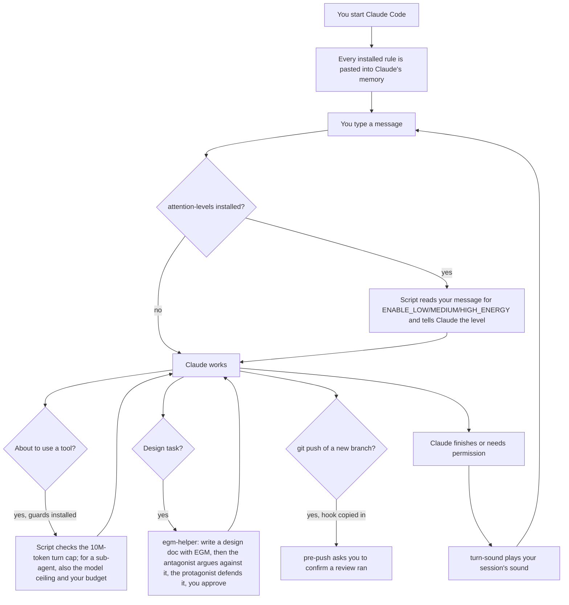

# agent-kit

My Claude Code setup, split into small plugins you can pick from. It adds rules that make the agent write safer code, debug more carefully and review plans before building them. Some extras are just fun, like a sound when it's your turn.

You don't need to understand any of it to install it. Copy the commands below.

## Before you start

You need [Claude Code](https://code.claude.com/docs/en/setup) installed and logged in. Check by opening a terminal and typing:

```
claude --version
```

If that prints a version number, you're ready.

## Install the Starter pack (recommended)

Paste these four lines into your terminal, one at a time. The last two add Google's design-doc workflow (EGM), which the Starter pack uses.

```
claude plugin marketplace add danyshs/agent-kit
claude plugin install starter@agent-kit
claude plugin marketplace add google/elephant-goldfish-model
claude plugin install egm@egm
```

Then start a new Claude Code session. The rules load at the start of every session.

To check everything installed, run `claude plugin list`. You should see `starter`, `tiger-style-core`, `debugging-discipline`, `antagonist-protagonist`, `egm-helper` and `egm`.

Works on macOS and Linux. Windows is untested. Last tested Claude Code version: see `SNAPSHOT`. The Starter rules add about 3,000 tokens to every session.

## How it works

### The four kinds of parts

Every plugin here is built from one or more of these:

| Part | What it is | When it's used |
|---|---|---|
| **Rule** | A page of plain-English instructions for Claude, like "check every claim against the code". | Pasted into Claude's memory at the start of every session, by a small hook that prints the rule's text. |
| **Skill** | A longer guide Claude reads only when it's needed, like the tiger-style coding rules. | Loaded when you ask for it ("review this with tiger style"). Costs nothing until then. |
| **Agent** | A helper Claude can start, with its own instructions and read-only access to your files. | Started by Claude when a rule tells it to (the antagonist and protagonist reviewers). |
| **Script** | A small program Claude Code runs on an event: when you send a message, before a tool runs, when Claude finishes. | Runs automatically. Claude doesn't choose to run it. |

### What happens during a session, in order



Step by step:

1. **Session starts.** Each rule plugin's hook prints its rule, and Claude reads it as instructions. Every rule begins with `rule: <name>`, so you can ask Claude which ones it has.
2. **You send a message.** With `attention-levels`, a script looks for `(ENABLE_LOW_ENERGY)`, `(ENABLE_MEDIUM_ENERGY)` or `(ENABLE_HIGH_ENERGY)`, saves the level for this session, and adds a line like `Attention level: Low` to your message. The rule tells Claude how many questions to ask at each level.
3. **Claude writes or reviews code.** If you ask for tiger style, Claude loads the `tiger-style` skill and the skill for your language, if you installed it. The `debugging-discipline` rule is always on.
4. **Before each tool call.** With `guards`, a script counts the tokens used this turn and stops at 10 million. Before a sub-agent starts, it also refuses models priced above Opus 5.5 and launches that would pass the budget you typed (`budget $5`).
5. **A task needs a design decision.** The `egm-helper` rule makes Claude write a design doc first, using Google's EGM plugin. Before you approve it, the `antagonist-protagonist` rule has Claude start two reviewers: one argues against the doc, the other defends it. Claude shows you a table of their points and you decide.
6. **Claude stops.** With `turn-sound`, a sound plays when Claude finishes or needs your permission. Each session gets its own sound, so you can tell parallel sessions apart.
7. **You push a new branch.** If you copied the `pre-push` git hook into the repo, it asks whether a code review ran. Claude can't answer a terminal prompt, so it runs a tiger-style review first and then pushes with `REVIEW_DONE=1`.

The other rules (`when-to-ask`, `agent-orchestration`, `single-evidence-ledger`, `code-voice`, `fork-pr-check`) have no scripts. They change how Claude behaves throughout the session.

### Every plugin and its parts

| Plugin | Rule | Skill | Agents | Scripts, and when they run | Files it writes |
|---|---|---|---|---|---|
| `starter` | none | none | none | none. Installing it installs the four below. | none |
| `tiger-style-core` | none | `tiger-style` (guide, principles, review checklist, TigerBeetle's original) | none | none | none |
| `tiger-style-<language>` (9) | none | one per language | none | none | none |
| `debugging-discipline` | yes | none | none | none | none |
| `antagonist-protagonist` | yes | none | `antagonist`, `protagonist` | none | `pushback_report.md` next to the doc being reviewed |
| `egm-helper` | yes | none (uses the EGM plugin's) | none | none | design docs under `docs/designs/` in your project |
| `when-to-ask` | yes | none | none | none | none |
| `attention-levels` | yes | none | none | `attention.py` on every message; `lowlog.py` when Claude logs a Low-level decision | `~/.claude/attention/`, `~/.claude/lowlog/` |
| `guards` | yes | none | none | `guard.py` before every tool call; price table `prices.json` | none (it only reads session logs) |
| `turn-sound` | none | none | none | `beep.sh` when Claude stops or asks permission | cached sounds in your temp folder |
| `pre-push` | yes | none | none | `git-hook/pre-push`, run by git, only if you copy it in | none |
| `agent-orchestration` | yes | none | none | none | none |
| `single-evidence-ledger` | yes | none | none | none | `FACTS.md` in your project, when Claude starts one |
| `code-voice` | yes | none | none | none | none |
| `fork-pr-check` | yes | none | none | none | none |

Not a plugin: `snippets/statusline.sh`, a status bar you can turn on by hand (see [SETUP.md](SETUP.md#status-line)).

### Where things are

- In this repo, each plugin is a folder under `plugins/`. Every rule is also a plain file in `rules/`, so you can read it before installing.
- On your computer, Claude Code keeps installed plugins under `~/.claude/plugins/`.

## What's in it

Install any single module with `claude plugin install <name>@agent-kit`. Remove one with `claude plugin uninstall <name>@agent-kit`.

### Starter pack (what `starter` installs)

| Module | What it does |
|---|---|
| `tiger-style-core` | Coding rules from TigerBeetle's TigerStyle: safety first, a limit on everything, lots of assertions. It loads only when you ask, for example "review this with tiger style". |
| `debugging-discipline` | Seven debugging rules, each from a real mistake. For example: exit code 0 doesn't prove a check passed. |
| `antagonist-protagonist` | Before you approve a plan, one agent argues against it and another defends it. You decide. |
| `egm-helper` | When to write a design doc first, and how to run Google's EGM review on it. |

### Language rules for tiger-style (pick the ones you use)

`tiger-style-python`, `tiger-style-typescript`, `tiger-style-rust`, `tiger-style-go`, `tiger-style-c`, `tiger-style-cpp`, `tiger-style-java`, `tiger-style-lua`, `tiger-style-fish`

Example: `claude plugin install tiger-style-python@agent-kit`

### Optional features

| Module | What it does |
|---|---|
| `turn-sound` | Plays a short sound when Claude is waiting for you. Each session gets its own sound. Needs jq and ffmpeg for the per-session sounds. Without them a Mac plays a system chime and Linux stays silent. |
| `attention-levels` | Type `(ENABLE_LOW_ENERGY)` on a tired day and Claude asks fewer questions. `(ENABLE_HIGH_ENERGY)` makes it ask more. `(ENABLE_MEDIUM_ENERGY)` is the normal setting. Needs python3. |
| `when-to-ask` | Claude just does safe, undoable work instead of asking "should I?", and runs all its checks before saying "done". |
| `guards` | Limits spending. Type `budget $5` and Claude can't launch sub-agents past $5. It also refuses any model priced above Opus 5.5, and stops after 10 million tokens in one turn. Prices are per-token API prices. Does nothing if python3 is missing. |
| `pre-push` | A git hook that asks you to confirm a code review ran before the first push of a branch. It's a reminder, not a lock: it can't check that a review really happened. Needs a manual step, see [SETUP.md](SETUP.md#pre-push). |

A status line (the bar under the prompt showing model, git branch, tokens and cost) is in `snippets/statusline.sh`. It isn't a plugin; [SETUP.md](SETUP.md#status-line) shows how to turn it on.

### Extras

| Module | What it does |
|---|---|
| `agent-orchestration` | When Claude should use sub-agents and when it shouldn't, and how to keep its memory uncluttered. |
| `single-evidence-ledger` | Each fact lives in one place. For long debugging, a `FACTS.md` file of facts, guesses and tests. |
| `code-voice` | My taste in comments and code: short, explains why, no class hierarchies by default. Take it only if you share the taste. |
| `fork-pr-check` | When working in a fork, makes Claude check the right repo before saying "there's no PR". |

## Is it working?

Start Claude Code and ask: "Quote every line in your context that starts with rule:". Each rule begins with a line like `rule: debugging-discipline`, so Claude should list one per installed rule module.

To check the tools the optional features need, download and run the doctor script:

```
curl -fsSL https://raw.githubusercontent.com/danyshs/agent-kit/main/bin/doctor | sh
```

## Not in the kit yet: evals and trajectory analysis

I also run two tools that aren't packaged yet. The trajectory tool reads past sessions so that the agent wastes fewer thoughts and the setup serves the user and the agent, instead of piling on rules that clutter the agent's context. The eval suite checks the rules themselves: does a rule say what it means, does it contradict another, does it cost more context than it's worth. The plan is to collect evidence for and against each rule from past sessions, so a rule that never helps shows up. They'll be added here when they work outside my own setup.

## Credits and licence

- TigerStyle is by TigerBeetle (Apache-2.0); the original guide is included unchanged in `tiger-style-core`.
- EGM (the Elephant-Goldfish Model) is by Google: https://github.com/google/elephant-goldfish-model
- Everything else is Apache-2.0, see [LICENSE](LICENSE).

`SNAPSHOT` says which Claude Code version this was last tested with.
