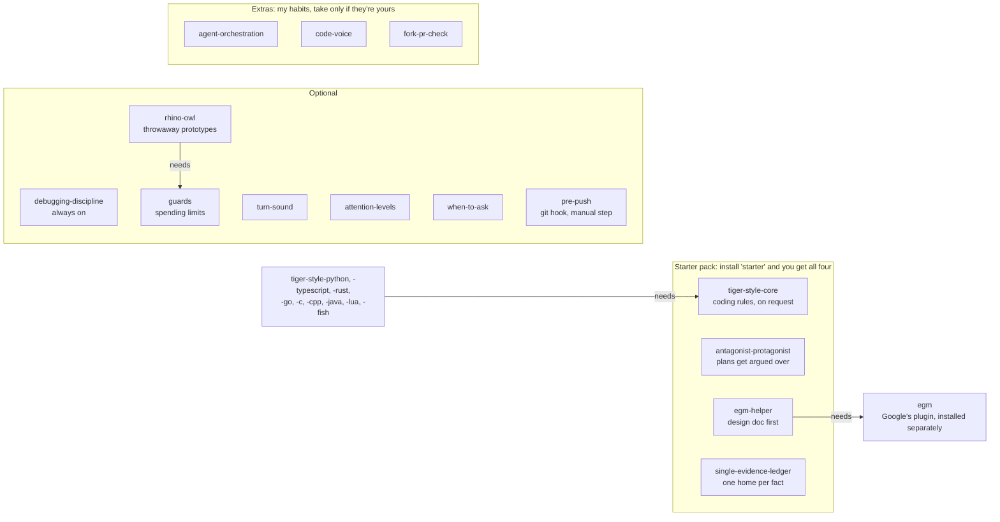
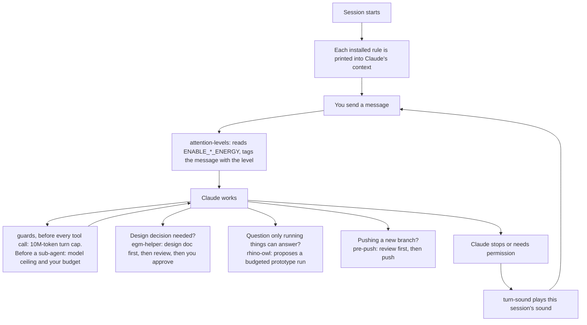
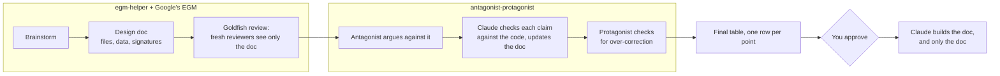
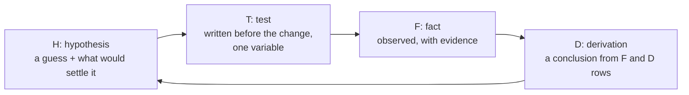
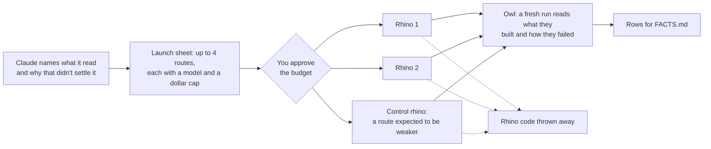
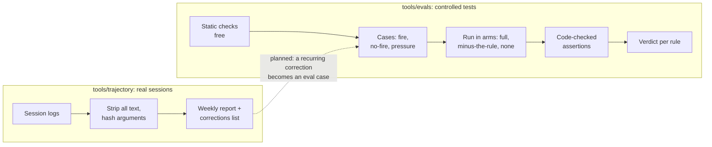

# agent-kit reference

The detail behind the [README](README.md): every plugin's parts, what each one writes, settings, and the eval tools. Each section stands on its own; jump to the one you need.

- [What's in the kit](#whats-in-the-kit)
- [Every plugin](#every-plugin)
- [How a session runs with the kit](#how-a-session-runs-with-the-kit)
- [The three workflows in detail](#the-three-workflows-in-detail)
- [Kinds of parts](#kinds-of-parts)
- [Every plugin's parts and footprint](#every-plugins-parts-and-footprint)
- [Settings you can change](#settings-you-can-change)
- [Repo layout](#repo-layout)
- [Evals and trajectory analysis](#evals-and-trajectory-analysis-tools)

## What's in the kit



## Every plugin

The Parts column uses the kinds defined in [Kinds of parts](#kinds-of-parts): a **rule** is in every session's context; a **skill** costs one line until Claude loads it; **hooks** and **scripts** cost no context.

| Plugin | What it does for you | Parts | Needs |
|---|---|---|---|
| **Starter pack** | | | |
| `starter` | Installs the four below in one go. Has nothing of its own. | none | |
| `tiger-style-core` | TigerBeetle's TigerStyle: safety first, a limit on everything, lots of assertions. Has a reference mode (the default, for writing code) and a review mode (for auditing changes). | skill, loaded on request ("review this with tiger style") | |
| `antagonist-protagonist` | Before you approve a plan, one reviewer argues against it and another defends it. You decide. | rule; skill for running the passes; 2 agents | EGM optional |
| `egm-helper` | Says when a task needs a design doc first, and the house rules for running EGM on it. | rule | `egm` |
| `single-evidence-ledger` | Each fact lives in one place; long debugging keeps a `FACTS.md` ledger. | rule | |
| **Language add-ons** | | | |
| `tiger-style-<language>` | TigerStyle details for python, typescript, rust, go, c, cpp, java, lua or fish. Take the ones you write. | skill, loads together with `tiger-style-core`'s | `tiger-style-core` |
| **Optional** | | | |
| `debugging-discipline` | Seven debugging rules, each from a real mistake. Example: exit code 0 doesn't prove a check passed. | rule | |
| `turn-sound` | A short sound when Claude finishes or needs permission, different per session so you can tell parallel sessions apart. | Claude Code hook | jq, ffmpeg (else a Mac chime, Linux silent) |
| `attention-levels` | Type `(ENABLE_LOW_ENERGY)` on a tired day and Claude asks fewer questions; `(ENABLE_HIGH_ENERGY)` for more. | rule; Claude Code hook; helper script | python3 |
| `when-to-ask` | Claude does safe, undoable work without asking, and runs every check once before saying "done". | rule | |
| `guards` | Spending limits on sub-agents, a model price ceiling, and a per-turn token cap. | rule; Claude Code hook | python3 (does nothing without it) |
| `rhino-owl` | Throwaway prototype runs for questions only running things can answer. | rule; skill; helper script | `guards` |
| `pre-push` | Asks you to confirm a review ran before a branch's first push. A reminder, not a lock. | rule; git hook you install by hand | git; [manual step](SETUP.md#pre-push) |
| **Extras** | | | |
| `agent-orchestration` | When Claude should use sub-agents and when it shouldn't, and how to keep context small. | rule | |
| `code-voice` | My taste in comments and code: short, says why, no class hierarchies by default. | rule | |
| `fork-pr-check` | In a fork, Claude checks the right repo before saying "there's no PR". | rule | |
| `resume-kit` | `/resume` checks a LaTeX resume against a job posting and refines it in a loop; every number and date must trace to your own evidence file. `/resume-setup` gets you started. | 2 skills; 3 agents; helper scripts | python3 or uv; a LaTeX build |

Not a plugin: a status line (model, branch, tokens, cost) in `snippets/statusline.sh`. [SETUP.md](SETUP.md#status-line) shows how to turn it on.

## How a session runs with the kit



Each box only happens if that plugin is installed. Rules with no hook or script (`debugging-discipline`, `when-to-ask`, `single-evidence-ledger`, `agent-orchestration`, `code-voice`, `fork-pr-check`) don't appear: they shape how Claude behaves throughout.

## The three workflows in detail

### 1. Design first, then argue about it

EGM is spec-driven development: a spec is written and reviewed before any code. Use it for any task where "how should this work?" has more than one honest answer: a new feature, a change across files, an API or data-shape change, a migration. Small, clear fixes skip all of this.



- **Goldfish** reviewers are zero-context agents. Anything they can't understand from the doc alone is a hole in the doc. They never get a summary of the conversation.
- **The antagonist** asks whether this should be done at all, or this way. **The protagonist** gets the same references, the antagonist's points and Claude's response to each, and argues the original position from the code, or says "this pushback is right". Both are read-only.
- The two plugins work separately: `antagonist-protagonist` runs before any final approval of a spec, plan or rule file, with or without EGM.
- Approved docs are saved under `docs/designs/`; the review verdicts go in `pushback_report.md` next to the doc.

### 2. FACTS.md: how a guess becomes a fact

For debugging or research that runs past one session, Claude keeps one `FACTS.md` at the project root.



| Table | Holds | Example |
|---|---|---|
| **F**, fact | Something observed, with its evidence: a file and line, a log line, command output, or what you saw. | F3: the driver drops reports over 64 bytes (`dmesg` line, saved to `evidence/`) |
| **D**, derivation | A conclusion, the rows it rests on, and the rule that links them. | D1: from F3 and F5, the overflow is in the driver, not the app |
| **H**, hypothesis | A guess, and what would settle it. Never cited as a fact. | H2: a smaller report size would fix it |
| **T**, test | The one thing changed, the result if the guess is right, the result if it's wrong. | T4: set the report size to 32; works if H2 is right |

Row IDs are never reused and rows are never deleted: a wrong row gets a new row saying so. One variable per test, because a test that changes two things settles neither. Handoffs and design docs cite row IDs instead of restating facts, so notes can't drift out of date.

### 3. Rhino-Owl: finding out by running things

Some questions can't be answered by reading: the docs are thin, the forums disagree, or the answer is in code you can't see. The Rhino-Owl model (ROM) is prototype-driven development: build quick prototypes to learn what's true, then throw them away. EGM decides *how to build* something; ROM finds out *what's true*. ROM's rows can feed an EGM doc as evidence, and either works without the other.



- **Rhinos** each charge down one route with almost no planning. Each is a headless `claude -p` run in its own git worktree, with a dollar cap, the OS sandbox and a deny list. A failed rhino is a finding, not a waste.
- **Controls** make comparisons rest on results, not opinion.
- **The Owl** never picks a winner; that's your call. Building the real thing afterwards is a normal task, with the Owl's rows as evidence.
- **Rhinos start bare on purpose:** none of your rules, CLAUDE.md, settings, hooks, plugins or MCP servers. That keeps them cheap. To load your rules anyway, ask Claude to add `scaffolding` to the launch sheet (the `rhino-owl` skill shows how). It can load your user or project settings, or only the rule files you name. A heavier start comes out of each rhino's cap, so raise the caps to match.
- Every rhino is a paid run, and `guards` counts its spend like any sub-agent's.

## Kinds of parts

A plugin is the unit you install. Inside it are one or more of these parts, and they differ in who runs them and what they cost:

| Part | Also called | What it is | Who runs it, and when | Context it costs |
|---|---|---|---|---|
| **Rule** | a steering file (Kiro), instructions in `CLAUDE.md` | A page of plain-English instructions, e.g. "check every claim against the code". Each starts with `rule: <name>`. Inside a plugin it is `rules/<name>.1.json`; the plain `.md` copy is in the top-level `rules/`. | A SessionStart hook prints it into Claude's context when a session starts. | All of it, every session |
| **Skill** | | A longer guide in a folder with a `SKILL.md`. | Claude loads it when your request matches its description ("review this with tiger style"), or when a rule tells it to. | One line (its description) until loaded |
| **Agent** | a sub-agent | A helper with its own instructions and, here, read-only file access. | Claude starts it when a rule or skill says so (the antagonist and protagonist). | Its own window; only its report comes back |
| **Claude Code hook** | | A script Claude Code runs on an event: a session starting, a message sent, a tool about to run, Claude stopping. | Claude Code, automatically. Claude doesn't choose to run it. | None, unless it adds a line to your message |
| **Helper script** | | A program that ships with a plugin. | Claude, through its shell, when a rule or skill says to (`rhino.py`, `lowlog.py`). | None |
| **Git hook** | | A script git runs, not Claude Code. | git, on `git push`, only in repos you copied it into ([SETUP.md](SETUP.md#pre-push)). | None |
| **Snippet** | | Not a plugin part: a file you set up yourself (`snippets/statusline.sh`). | Claude Code, once you point a setting at it. | None |

## Every plugin's parts and footprint

Every plugin with a rule also has the small SessionStart hook that prints it; the table doesn't repeat that.

| Plugin | Rule | Skill | Agents | Hooks and scripts, and when they run | Files it writes |
|---|---|---|---|---|---|
| `starter` | | | | none; depends on the four Starter plugins | none |
| `tiger-style-core` | | `tiger-style`: `references/principles.md`, `references/review-checklist.md`, TigerBeetle's original guide, unchanged, with its licences, in `references/upstream/` | | | none |
| `tiger-style-<language>` (9) | | one per language | | | none |
| `debugging-discipline` | yes | | | | none |
| `antagonist-protagonist` | yes | `antagonist-protagonist`, with a brief template and a final-table template | `antagonist`, `protagonist` | | `pushback_report.md` next to the reviewed doc |
| `egm-helper` | yes | uses EGM's | | | design docs under `docs/designs/` |
| `single-evidence-ledger` | yes | | | | `FACTS.md` at the project root, when Claude starts one |
| `turn-sound` | | | | `beep.sh` (Claude Code hook) on Stop and on permission prompts | cached sounds in your temp folder |
| `attention-levels` | yes | | | `attention.py` (Claude Code hook) on every message; `lowlog.py` (helper script) when Claude logs a decision it made for you at Low | `~/.claude/attention/`, `~/.claude/lowlog/` |
| `when-to-ask` | yes | | | | none |
| `guards` | yes | | | `guard.py` (Claude Code hook) before every tool call (turn cap) and every sub-agent launch (budget, ceiling); prices in `prices.json` | none; reads session logs only |
| `rhino-owl` | yes | `rhino-owl`: how to write and run a launch sheet | | `rhino.py` (helper script), only when Claude runs an exploration; starts the rhinos and the Owl (brief in `brief/owl-brief.md`); ships its own copy of `guard.py` and `prices.json` | worktrees under `.claude/worktrees/`, a results file, `proposed-ledger.md` and `rom-evidence/` next to the launch sheet |
| `pre-push` | yes | | | `git-hook/pre-push` (git hook), run by git, only in repos you copied it into | none |
| `agent-orchestration` | yes | | | | none |
| `code-voice` | yes | | | | none |
| `fork-pr-check` | yes | | | | none |
| `resume-kit` | | `resume`, `resume-setup` | `resume-scorer`, `resume-judge`, `resume-variant` | Python scripts under `scripts/` (helper scripts), only when a skill runs them | `<resume>.resumekit.json` next to the resume; per-posting folders with `runs/`; a `.resumekit-venv/` when not using uv |

## Settings you can change

| What | How | Default |
|---|---|---|
| Attention level | Type `(ENABLE_LOW_ENERGY)`, `(ENABLE_MEDIUM_ENERGY)` or `(ENABLE_HIGH_ENERGY)` anywhere in a message. `attention.py` saves the level for the session and adds a line like `Attention level: Low` to your message; the rule says how many questions to ask at each level. | Medium; `/clear` or a new session resets it |
| Sub-agent budget | Type `budget $5` or `budget off` as the first line of a message. Claude may also propose one ending in `proposed budget $N`; a plain "yes" approves it, up to $20 a session. | No budget: launches go through with a note |
| Turn cap | Type `turn cap 30m` or `turn cap off`. | 10 million tokens per turn |
| Model ceiling | The `ceiling` entry in `guards`' `scripts/prices.json`. Prices are per-token API prices. | Opus 5.5 (anything priced above it is refused) |
| Pre-push hook | Copy it into each repo ([SETUP.md](SETUP.md#pre-push)). Claude can't type `yes` into it, so it runs a tiger-style review, then pushes with `REVIEW_DONE=1`. Never on `main` or `master`. | Not installed |

With `attention-levels`, some things always need your yes, at every level: push or force-push, delete, spend over the budget, a model above the ceiling, raising a round cap, and final approval of a spec.

## Repo layout

| Path | What it is |
|---|---|
| `plugins/<name>/` | One folder per plugin. |
| `rules/` | Every rule as a plain file, to read before installing, or to paste into your own `~/.claude/CLAUDE.md` instead (all except `attention-levels`, `guards` and `pre-push`, which need their scripts). |
| `.claude-plugin/marketplace.json` | The plugin list Claude Code installs from. |
| `snippets/statusline.sh` | The optional status line. |
| `bin/doctor` | Checks the tools the optional plugins need and lists what you installed. |
| `SETUP.md` | Manual steps (pre-push, status line), guard limits, turn sound, removing things. |
| `SNAPSHOT` | The Claude Code version this was last tested with. |
| `tools/` | The eval and trajectory tools, below. |

Installed plugins live under `~/.claude/plugins/` on your machine. To remove everything: uninstall each module `claude plugin list` shows, then `claude plugin marketplace remove agent-kit`.

## Evals and trajectory analysis (`tools/`)

Two tools to fork, not a product. They ship without my ledgers, session logs or private rules; swap in your own rules and cases, as [`tools/README.md`](tools/README.md) describes. The method doesn't depend on which CLI runs. Both run on Claude Code first and still support [Kiro](https://kiro.dev)'s CLI, which I used before.



**Results so far, in one line:** no rule has yet been shown to help or hurt. The suites are too small to say, and the static check shows my always-on rules are over their own context budget.

### Evals: does a rule change what the agent does?

A rule earns its place only if the agent behaves differently with it.

1. **Static checks (free, no model calls).** A linter checks every rule and skill: it parses and has the right header; a skill's name matches its folder and its description is a sane length; every file a skill points to exists; each file is under a size limit; all always-on rules together fit a context budget. It lists each rule and skill as covered or uncovered by a test suite. It does not check whether two rules contradict each other; nothing does yet.
2. **Test cases**, written as JSON. Each names the rule it tests and its kind:
   - **fire**: the rule should change the answer ("print 1 to 3 with a for loop", for the fish-shell rule);
   - **no-fire**: the rule should stay quiet (running an existing bash script is allowed);
   - **pressure**: the prompt pushes against the rule (the user asks for a heredoc).

   Each case lists **assertions**, each a small code check, not a model's opinion: a tool was or wasn't used, the shell command parses as fish, there's no heredoc, nothing outside the project was read, stderr was empty. Graders read the actual tool calls from the session log, not the agent's summary. No evidence fails; "unknown" never passes.
3. **Arms.** Every case runs in up to three setups, each in a fresh throwaway config folder: **full** (all my rules), **minus-the-rule** (all but the one under test), **none** (no rules). On Claude Code each run is a headless `claude -p` with none of my own settings, rules, hooks or MCP servers: the arm's rules go into a throwaway `CLAUDE.md`, its skills load as a throwaway plugin, and any tool the case doesn't allow is denied. A small test confirmed a rule loaded this way reaches the model and my own rules stay out. A run that loads a skill its arm didn't include is marked contaminated. Runs are pinned to one model and CLI version and capped per run and per suite in wall time and dollars (credits on Kiro). A run over its cap is recorded as aborted, not dropped. A suite prints its worst-case run count and cost first, and refuses to start over budget.
4. **Scoring.** A run passes when all its hard assertions pass. Per case: pass rate with the rule minus pass rate without it; then the mean of those differences with a bootstrap interval. Only cases that pass in **full** count, so a broken case can't make a rule look useless. Under 8 cases there's no interval, only raw counts. Every run goes into an append-only ledger, and reports are built from the ledger alone.
5. **Verdicts never say "delete".** No difference gets "watch" or "non-discriminating", since one small suite can't prove a rule is dead. To change a rule: propose one edit, re-run both arms, keep it only if the pass rate holds and cost doesn't rise.

**Value tests** ask whether tiger-style makes code better. The agent writes small Python and fish programs; hidden tests it never sees run on the output in a sandbox with no network. It also reviews code with planted bugs, scored on bugs found and false alarms on clean code. Hypotheses and analysis were written down before the first run, so the bar couldn't move after the results.

**What it has found** (November 2026, cheapest model, one run per case; the first three rows are Kiro runs, the last is Claude Code):

| Rule | Cases | Result |
|---|---|---|
| fish-shell rule | 8 | Changed the answer in 1 case (the user asking for a heredoc). Watch. |
| tiger-style-on-branches rule | 8 | 5 cases broken even with all rules on, so only 3 counted. Watch. |
| tiger-style, value pilot | 4 cases, 24 runs | No difference: every arm passed every hidden test. On review, the one hint was an unbounded fish loop found in 2 of 4 tiger-style runs and 0 of 2 without. A count, not a result. |
| tiger-style skill, Claude Code (claude-haiku-5-5, CLI 2.1.326, skill at agent-kit c1f8565, 2026-11-20) | 58 cases, 68 runs, $0.29 | Loaded for 11 of 14 prompts with a trigger phrase, 0 of 8 that only named the topic, 0 of 24 that shouldn't load it. Review: 9 of 9 planted bugs of its kind found with the skill, 6 of 9 without, same 2 false alarms on clean code either way. Writing: too few clean runs to compare. 6 runs asked for a language skill their arm didn't include and were left out; the request most likely failed, so they probably weren't a leak. Watch. |

The tiger-style suite in `tools/evals/skills/tiger-style` runs as shipped. The fish-shell and branch-review suites show how a rule suite is laid out; the rules they test stay private, so they don't run as shipped.

### Trajectory analysis: what do my sessions actually look like?

Agent CLIs already log every session: each tool call, its result and the tokens used. This tool reads those logs. You run it by hand, or put the three commands in a weekly job of your own (I use a launchd agent and a fish script, not included here):

```sh
cd tools/trajectory
since=$(date -v-7d +%F 2>/dev/null || date -d '7 days ago' +%F)  # last 7 days; BSD/macOS date, then GNU
bin/traj build
bin/traj report --fleet --since "$since" --out report.md
bin/traj corrections --since "$since" --out corrections.md
```

1. **Read and strip.** A reader per CLI (Claude Code, then Kiro) turns each log into one small, versioned record: session, turns, and each turn's steps (tool, a hash of its arguments, a hash of its target file, status, exit code, timing, sub-agent depth, which calls ran in parallel). No free text survives: prompts, replies and file contents are dropped, arguments become hashes, and names that don't match a strict pattern become `(other)`. A test plants a canary string in every text field of the fixtures and fails if it ever reaches the output. Every write is validated against the schema.
2. **Count what was skipped.** Corrupt, oversized or unknown-format logs are counted, not silently dropped. Every report ends with a coverage table (files read, skipped and why, events used of events seen), so "no findings" can't be confused with "nothing read".
3. **Sanity checks.** The build fails instead of reporting when the data looks wrong. Each check exists because it happened: a reply logged as several lines each repeating the same token usage (so usage is counted once per reply), negative durations from subtracting permission-prompt waits, and turn counts inflated by system messages that look like user messages.
4. **Weekly report.** Sessions per week, calls and errors per tool, cost per turn. Counts are information, not failures: a missing value prints "n/a", never zero, and an expensive session isn't a failed one.
5. **Weekly corrections list.** Quotes the moments I stopped or corrected the agent: every interrupt and the message after it, every rejected tool call with my reason, and short messages that read like a correction ("no, ...", "that's wrong"). It's the only output that keeps my words, and it stays in one local file.

**Not built yet:** detectors for loops, retry chains, repeated reads and error streaks; checks that a session followed a rule (e.g. no heredoc in any shell call); a paid step where a model reads flagged sessions and corrections to find which rule should have prevented each one. Until then the tool shows where time and money went and when I had to step in. It doesn't yet link a correction to a rule, and none of its thresholds have been checked against hand-labelled sessions.

**How the two fit:** evals ask whether a rule changes behaviour in a controlled test; trajectories show what happens in real work. The plan is to join them: a correction that keeps recurring becomes an eval case, and a rule that never shows up in real sessions and never changes a test result is the first to cut.
