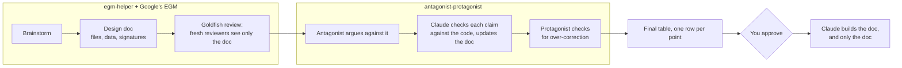

# egm-helper

Says when a task needs a design doc before any code, and the house rules for running Google's EGM (Elephant-Goldfish Model) review on it: fresh reviewers who see only the doc.

    claude plugin marketplace add google/elephant-goldfish-model
    claude plugin install egm@egm
    claude plugin install egm-helper@agent-kit

Needs `egm`. Without it, Claude says once that the rule needs it and ignores the rest.

## Parts

| Part | File | When it runs |
|---|---|---|
| Rule | `rules/egm-helper.1.json` ([plain copy](../../rules/egm-helper.md)) | In context from the start of every session: when a task needs a design doc first |
| Skill | `skills/egm-helper/SKILL.md` | Claude reads it when the trigger fires: the doc header, reviewer limits, building to the spec, and what to do when you want to skip the doc |

## Design first, then argue about it

EGM is spec-driven development: a spec is written and reviewed before any code. It's for any task where "how should this work?" has more than one honest answer: a new feature, a change across files, an API or data-shape change, a migration. Small, clear fixes skip all of this.

- **Goldfish** reviewers are zero-context agents. Anything they can't understand from the doc alone is a hole in the doc. They never get a summary of the conversation.
- The second half is [`antagonist-protagonist`](../antagonist-protagonist/README.md), a separate install.

## Files it writes

Design docs under `docs/designs/`.

Back to the [plugin list](../../README.md#plugin-docs).
