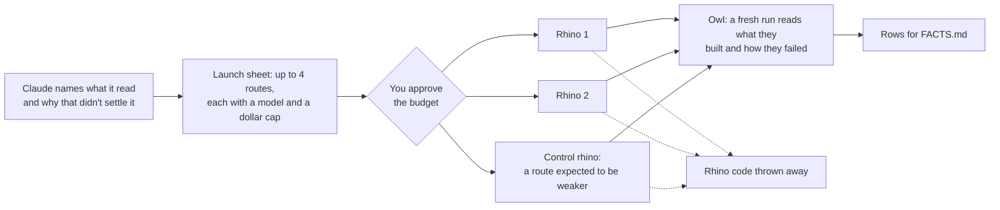

# rhino-owl

Throwaway prototype runs for questions only running things can answer. Keeps the findings, throws the code away.

    claude plugin install rhino-owl@agent-kit

Needs [`guards`](../guards/README.md), which counts each run's spend like any sub-agent's.

## Parts

| Part | File | When it runs |
|---|---|---|
| Rule | `rules/rhino-owl.1.json` ([plain copy](../../rules/rhino-owl.md)) | In context from the start of every session: when a question calls for it |
| Skill | `skills/rhino-owl/SKILL.md` | Claude reads it before proposing a run: roles, hard lines, and how to write and run a launch sheet |
| Helper script | `scripts/rhino.py` | Only when Claude runs an exploration: starts the rhinos and then the Owl, whose brief is `brief/owl-brief.md`. It ships its own copy of `guard.py` and `prices.json` |

## Finding out by running things

Some questions can't be answered by reading: the docs are thin, the forums disagree, or the answer is in code you can't see. The Rhino-Owl model is prototype-driven: build quick prototypes to learn what's true, then throw them away. EGM decides *how to build* something; this finds out *what's true*. Its rows can feed a design doc as evidence, and either works without the other.

- **Rhinos** each charge down one route with almost no planning. Each is a headless `claude -p` run in its own git worktree, with a dollar cap, the OS sandbox and a deny list. A rhino can't push: the launch sets git's push URL to a dead one, and refuses a remote that sets its own. A failed rhino is a finding, not a waste.
- **Controls** make comparisons rest on results, not opinion.
- **The Owl** never picks a winner; that's your call. Building the real thing afterwards is a normal task, with the Owl's rows as evidence.
- **Rhinos start bare on purpose:** none of your rules, CLAUDE.md, settings, hooks, plugins or MCP servers. That keeps them cheap. To load your rules anyway, ask Claude to add `scaffolding` to the launch sheet (the skill shows how). It can load your user or project settings, or only the rule files you name. A heavier start comes out of each rhino's cap, so raise the caps to match.

## Files it writes

Worktrees under `.claude/worktrees/`, removed once you accept the Owl's rows; and next to the launch sheet, a results file, `proposed-ledger.md` and `rom-evidence/`.

Back to the [plugin list](../../README.md#plugin-docs).
