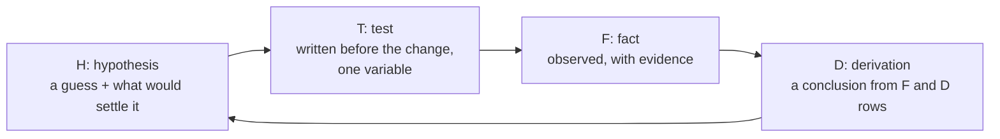

# single-evidence-ledger

Keeps what Claude knows trustworthy across sessions. Every fact has one home and other notes point to it; a status line says when it was last checked and against what; and long research or debugging keeps a `FACTS.md` where a guess can't pass as a fact. Part of the Starter pack.

    claude plugin install single-evidence-ledger@agent-kit

## Parts

| Part | File | When it runs |
|---|---|---|
| Rule | `rules/single-evidence-ledger.1.json` ([plain copy](../../rules/single-evidence-ledger.md)) | In context from the start of every session: one home per fact, current state only, dated claims |
| Skill | `skills/single-evidence-ledger/SKILL.md` | Claude reads it before creating or editing `FACTS.md`, a handoff or a status doc: every rule in full, and the ledger below |

## FACTS.md: how a guess becomes a fact

For debugging or research that runs past one session, Claude keeps one `FACTS.md` at the project root.

| Table | Holds | Example |
|---|---|---|
| **F**, fact | Something observed, with its evidence: a file and line, a log line, command output, or what you saw. | F3: the driver drops reports over 64 bytes (`dmesg` line, saved to `evidence/`) |
| **D**, derivation | A conclusion, the rows it rests on, and the rule that links them. | D1: from F3 and F5, the overflow is in the driver, not the app |
| **H**, hypothesis | A guess, and what would settle it. Never cited as a fact. | H2: a smaller report size would fix it |
| **T**, test | The one thing changed, the result if the guess is right, the result if it's wrong. | T4: set the report size to 32; works if H2 is right |

Row IDs are never reused and rows are never deleted: a wrong row gets a new row saying so. One variable per test, because a test that changes two things settles neither. Handoffs and design docs cite row IDs instead of restating facts, so notes can't drift out of date. [`rhino-owl`](../rhino-owl/README.md) writes its findings as rows for this file.

## Files it writes

`FACTS.md` at the project root, when Claude starts one.

Back to the [plugin list](../../README.md#plugin-docs).
