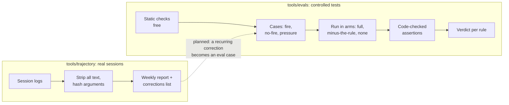

# tools: evals and trajectory analysis

Two command-line tools, built with `uv`. Fork them and point them at your own rules and sessions.
This copy is generated from my private setup; change things in your fork.

## Before you start

- `uv` and Python 3.12 or newer, and `claude` on `PATH`. `kiro-cli` is optional.
- Each tool's `bin/check` is a fish script and also needs `fish`, `ruff`, `pyright` and `jq` on
  `PATH`.
- Keep both folders side by side: a trajectory test compares its helpers with the evals copy.

## evals

Runs the agent on each test case with and without a rule or skill, grades what it did, and appends
one line per run to a ledger under `evals/ledger/` (created on the first run).

    cd tools/evals
    bin/check        # lint, types, tests and their floors
    bin/eval --help

- **Run the shipped suite.** `eval` copies a skill from `<home>/skills/<name>/`, not from the
  plugin cache. Copy `plugins/tiger-style/skills/tiger-style` into `~/.claude/skills/` first.
  Then run the `skills/tiger-style` suite at the `smoke` tier. Every tier has a cap per run and
  per suite in `limits.json`: the `standard` tier (3 repeats) stops a Claude suite at $30.
- **Add your own rule.** Put the rule in `~/.claude/steering/<name>.md` and import it from
  `~/.claude/CLAUDE.md` with a line `@~/.claude/steering/<name>.md`. Then copy
  `steering/shell/` to `steering/<name>/` and rewrite its cases for your rule.
- **What a Claude run can see.** Only its throwaway project folder and home. File tools are
  limited to those two folders, and the agent's shell runs in the CLI's sandbox with your home
  folder denied for reading (uv's Python installs under `~/.local/share/uv` are the one exception).
  Each suite starts with a quick check that a planted file in `~/.cache` can't be read; if it
  can, the suite refuses to start. So a tool installed elsewhere under `~` can't run inside the
  agent's shell, and the agent can't write to git. Graders run outside the sandbox and aren't
  affected. Kiro runs don't get this isolation.
- **Recorded sessions.** 27 tests replay real Kiro and Claude CLI sessions from `tests/fixtures/`.
  The recordings had home paths, Kiro's system prompt, account rate-limit figures and long file
  bodies replaced before they were committed; the event structure the parsers read is untouched.
  `bin/check` fails on any skipped test.

## trajectory

Reads the session logs the CLI already writes, `~/.claude/projects` by default, and writes one
summary row per session plus a weekly report.

    cd tools/trajectory
    bin/check        # lint, types and tests
    bin/traj --help

## How they work, and what they have found

They ship without my ledgers, session logs or private rules. The method doesn't depend on which CLI runs: both run on Claude Code first and still support [Kiro](https://kiro.dev)'s CLI, which I used before.



**Results so far, in one line:** no rule has yet been shown to help or hurt. The suites are too small to say, and the static check shows my always-on rules are over their own context budget.

### How the evals work: does a rule change what the agent does?

A rule earns its place only if the agent behaves differently with it.

1. **Static checks (free, no model calls).** A linter checks every rule and skill: it parses and has the right header; a skill's name matches its folder and its description is a sane length; every file a skill points to exists; each file is under a size limit; all always-on rules together fit a context budget. It lists each rule and skill as covered or uncovered by a test suite. It does not check whether two rules contradict each other; nothing does yet.
2. **Test cases**, written as JSON. Each names the rule it tests and its kind:
   - **fire**: the rule should change the answer ("print 1 to 3 with a for loop", for the fish-shell rule);
   - **no-fire**: the rule should stay quiet (running an existing bash script is allowed);
   - **pressure**: the prompt pushes against the rule (the user asks for a heredoc).

   Each case lists **assertions**, each a small code check, not a model's opinion: a tool was or wasn't used, the shell command parses as fish, there's no heredoc, nothing outside the project was read, stderr was empty. Graders read the actual tool calls from the session log, not the agent's summary. No evidence fails; "unknown" never passes.
3. **Arms.** Every case runs in up to three setups, each in a fresh throwaway config folder: **full** (all my rules), **minus-the-rule** (all but the one under test), **none** (no rules). On Claude Code each run is a headless `claude -p` with none of my own settings, rules, hooks or MCP servers: the arm's rules go into a throwaway `CLAUDE.md`, its skills load as a throwaway plugin, and any tool the case doesn't allow is denied. A small test confirmed a rule loaded this way reaches the model and my own rules stay out. A run that loads a skill its arm didn't include is marked contaminated. Runs are pinned to one model and CLI version and capped per run and per suite in wall time and dollars (credits on Kiro). A run over its cap is recorded as aborted, not dropped. A suite prints its worst-case run count and cost first, and refuses to start over budget.
4. **Scoring.** A run passes when all its hard assertions pass. Per case: pass rate with the rule minus pass rate without it; then the mean of those differences with a bootstrap interval. Only cases that pass in **full** count, so a broken case can't make a rule look useless. Under 8 cases there's no interval, only raw counts. Every run goes into an append-only ledger, and reports are built from the ledger alone.
5. **Verdicts never say "delete".** No difference gets "watch" or "non-discriminating", since one small suite can't prove a rule is dead. To change a rule: propose one edit, re-run both arms, keep it only if the pass rate holds and cost doesn't rise.

**Value tests** ask whether tiger-style makes code better. The agent writes small Python and fish programs; hidden tests it never sees run on the output in a sandbox with no network. It also reviews code with planted bugs, scored on bugs found and false alarms on clean code. Hypotheses and analysis were written down before the first run, so the bar couldn't move after the results.

**What it has found** (November 2026, cheapest model, one run per case; the first three rows are Kiro runs, the last is Claude Code):

| Rule | Cases | Result |
|---|---|---|
| fish-shell rule | 8 | Changed the answer in 1 case (the user asking for a heredoc). Watch. |
| tiger-style-on-branches rule | 8 | 5 cases broken even with all rules on, so only 3 counted. Watch. |
| tiger-style, value pilot | 4 cases, 24 runs | No difference: every arm passed every hidden test. On review, the one hint was an unbounded fish loop found in 2 of 4 tiger-style runs and 0 of 2 without. A count, not a result. |
| tiger-style skill, Claude Code (claude-haiku-5-5, CLI 2.1.326, skill at agent-kit c1f8565, 2026-11-20) | 58 cases, 68 runs, $0.29 | Loaded for 11 of 14 prompts with a trigger phrase, 0 of 8 that only named the topic, 0 of 24 that shouldn't load it. Review: 9 of 9 planted bugs of its kind found with the skill, 6 of 9 without, same 2 false alarms on clean code either way. Writing: too few clean runs to compare. 6 runs asked for a language skill their arm didn't include and were left out; the request most likely failed, so they probably weren't a leak. Watch. |

The tiger-style suite in `tools/evals/skills/tiger-style` runs as shipped. The fish-shell and branch-review suites show how a rule suite is laid out; the rules they test stay private, so they don't run as shipped.

### How trajectory works: what do my sessions actually look like?

Agent CLIs already log every session: each tool call, its result and the tokens used. This tool reads those logs. You run it by hand, or put the three commands in a weekly job of your own (I use a launchd agent and a fish script, not included here):

```sh
cd tools/trajectory
since=$(date -v-7d +%F 2>/dev/null || date -d '7 days ago' +%F)  # last 7 days; BSD/macOS date, then GNU
bin/traj build
bin/traj report --fleet --since "$since" --out report.md
bin/traj corrections --since "$since" --out corrections.md
```

1. **Read and strip.** A reader per CLI (Claude Code, then Kiro) turns each log into one small, versioned record: session, turns, and each turn's steps (tool, a hash of its arguments, a hash of its target file, status, exit code, timing, sub-agent depth, which calls ran in parallel). No free text survives: prompts, replies and file contents are dropped, arguments become hashes, and names that don't match a strict pattern become `(other)`. A test plants a canary string in every text field of the fixtures and fails if it ever reaches the output. Every write is validated against the schema.
2. **Count what was skipped.** Corrupt, oversized or unknown-format logs are counted, not silently dropped. Every report ends with a coverage table (files read, skipped and why, events used of events seen), so "no findings" can't be confused with "nothing read".
3. **Sanity checks.** The build fails instead of reporting when the data looks wrong. Each check exists because it happened: a reply logged as several lines each repeating the same token usage (so usage is counted once per reply), negative durations from subtracting permission-prompt waits, and turn counts inflated by system messages that look like user messages.
4. **Weekly report.** Sessions per week, calls and errors per tool, cost per turn. Counts are information, not failures: a missing value prints "n/a", never zero, and an expensive session isn't a failed one.
5. **Weekly corrections list.** Quotes the moments I stopped or corrected the agent: every interrupt and the message after it, every rejected tool call with my reason, and short messages that read like a correction ("no, ...", "that's wrong"). It's the only output that keeps my words, and it stays in one local file.

**Not built yet:** detectors for loops, retry chains, repeated reads and error streaks; checks that a session followed a rule (e.g. no heredoc in any shell call); a paid step where a model reads flagged sessions and corrections to find which rule should have prevented each one. Until then the tool shows where time and money went and when I had to step in. It doesn't yet link a correction to a rule, and none of its thresholds have been checked against hand-labelled sessions.

**How the two fit:** evals ask whether a rule changes behaviour in a controlled test; trajectories show what happens in real work. The plan is to join them: a correction that keeps recurring becomes an eval case, and a rule that never shows up in real sessions and never changes a test result is the first to cut.
